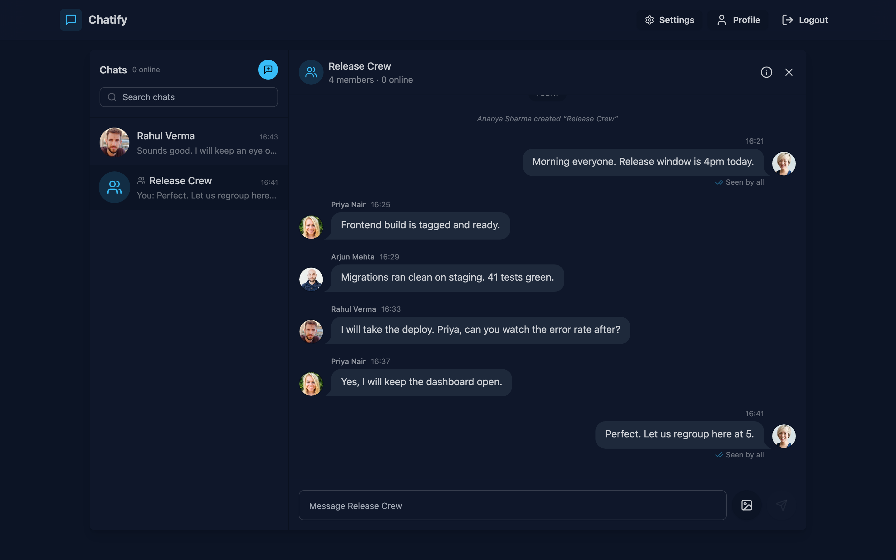
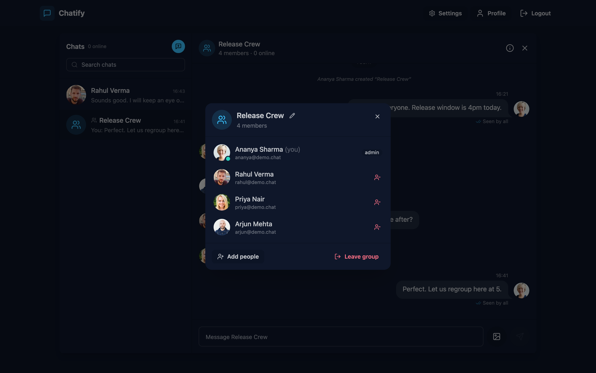
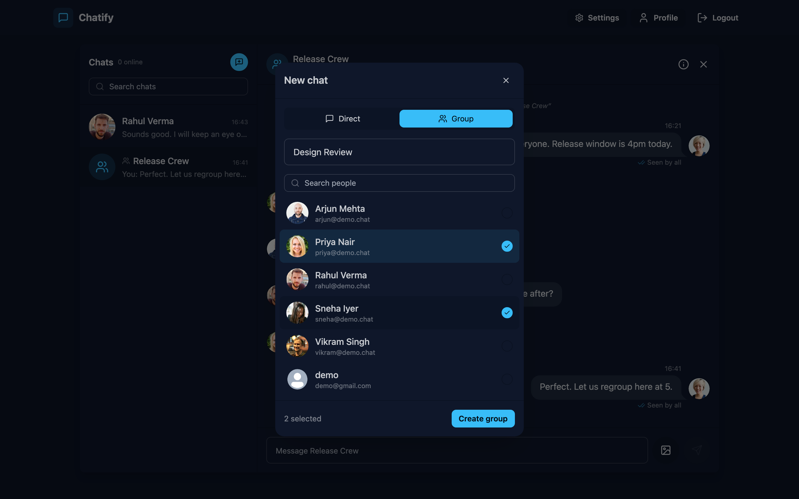
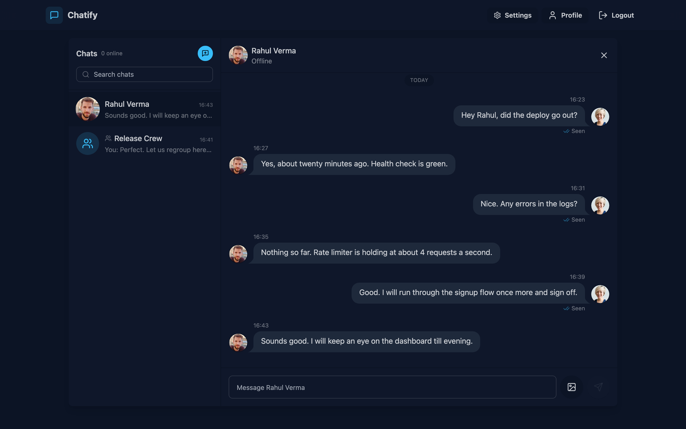
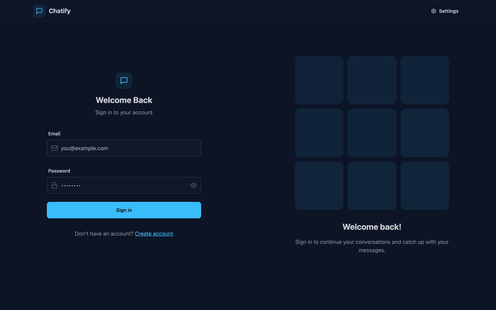
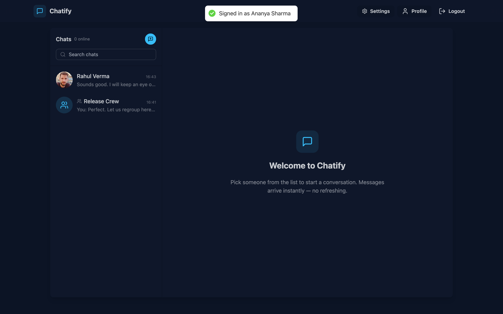
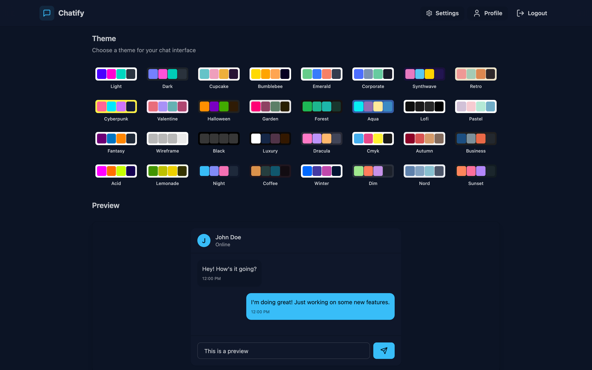
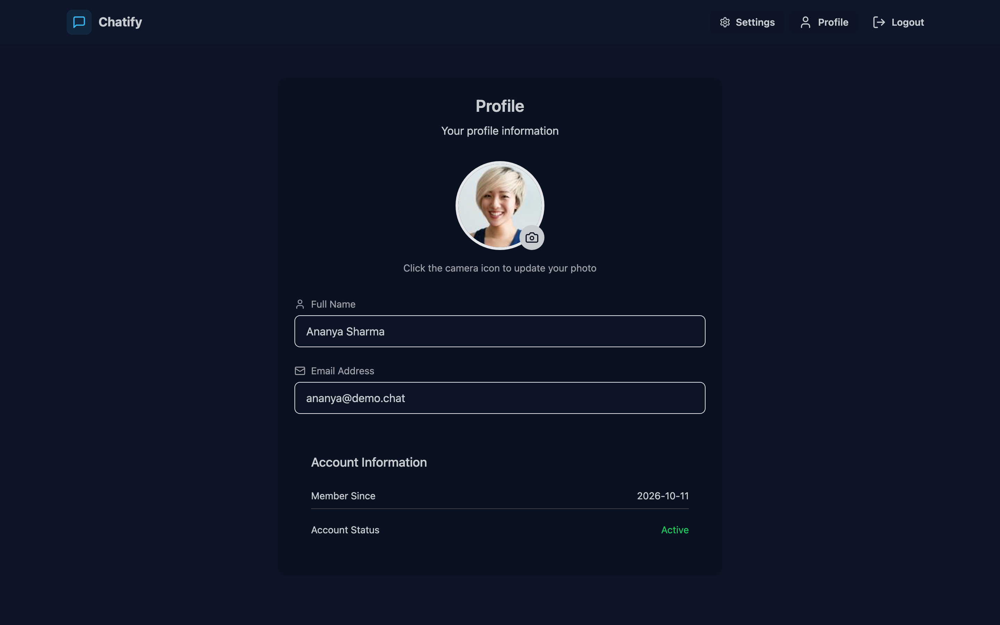

# Chatify

> Real-time chat with direct messages and groups: presence, typing indicators, read receipts, photos and message deletion.

**[Live demo](https://chatify-13-205-125-184.sslip.io)** · Login `ananya@demo.chat` / `demo1234` (open a second browser as `rahul@demo.chat` to watch messages arrive live)

**Stack:** React · Vite · Tailwind/daisyUI · Express · Socket.IO · MongoDB · AWS S3 · Docker · AWS EC2

## At a glance

- **Realtime that holds up:** one Socket.IO room per conversation with cookie-authenticated sockets; membership is checked on every event, typing clears on disconnect, and missed messages are fetched after a reconnect.
- **Accurate receipts:** "Seen by N" counts each reader once, using their previous read time; unread counts are computed in MongoDB instead of loading message history.
- **Private media:** photos are re-encoded to WebP with location data stripped, kept in a private S3 bucket, and served only to members of that chat; messages can be deleted for everyone and chats cleared for yourself.
- **Deployed and tested:** runs on AWS EC2 with Docker Compose and Caddy (automatic HTTPS); 112 automated tests (103 API, 3 UI, 6 Playwright journeys driving three users at once), run against the live site.



---

## What it does

| | |
|---|---|
| **Direct messages** | One-to-one chats, created the first time you message someone |
| **Group chats** | Up to 100 people, with admins, a member list, rename, add, remove and leave |
| **Real-time messaging** | Socket.IO delivers a message to every tab every member has open, with no polling |
| **Presence** | A live list of who is online, tracked per connection so several tabs do not fight each other |
| **Typing indicators** | Scoped to the conversation, and in a group it names who is typing |
| **Read receipts** | *Sent* → *Seen* in a direct chat; *Seen by 3* → *Seen by all* in a group |
| **Delete** | Delete your own message for everyone ("This message was deleted"), or clear a chat for yourself only |
| **System notes** | "Ananya added Priya", "Rahul left the group" — recorded in the transcript |
| **Unread counts** | Per-conversation badges, counted per member, most recent chat on top |
| **Image sharing** | Photos, avatars and group pictures are re-encoded to WebP (max 1280px, location data stripped) and kept in a private S3 bucket; `/api/media` serves them only to people allowed to see them |
| **Contact search** | Filter by name or email, plus an "online only" toggle |
| **Conversation previews** | Each row shows the last message, who sent it, and when |
| **Desktop alerts** | A chime, and a system notification when the tab is in the background |
| **Paginated history** | Loads 40 messages at a time and fetches older ones as you scroll up |
| **32 themes** | daisyUI themes, remembered per browser |
| **Auth** | Email + password, bcrypt hashes, a signed httpOnly cookie that JavaScript cannot read |
| **Built for a phone** | The contact list and the conversation take turns on a narrow screen |

---

## Running it

### Option 1 — Docker (one command)

```bash
docker compose up --build
```

Open <http://localhost:5001>. This starts MongoDB and the app together.
MongoDB is published on **27018**, so it will not clash with one already
installed on your machine.

To load the demo accounts:

```bash
docker compose exec app node src/seeds/user.seed.js
```

### Option 2 — Local Node

You need Node 18+ and a MongoDB you can reach (local, or a free Atlas cluster).

```bash
# 1. configure
cp backend/.env.example backend/.env     # then fill in MONGO_URI and JWT_SECRET

# 2. install
npm install --prefix backend
npm install --prefix frontend

# 3. demo data (optional but recommended)
npm run seed

# 4. two terminals
npm run dev:api      # API + websocket on :5001
npm run dev:web      # app on :5173
```

Vite proxies `/api` and `/socket.io` to the API, so the browser only ever sees
one origin — the same arrangement as production.

### Upgrading an existing database

Databases written before group chat existed stored `senderId` + `receiverId` on
each message and had no `conversations` collection. A one-off script converts
them:

```bash
node src/scripts/migrate-to-conversations.js --dry-run   # report only
node src/scripts/migrate-to-conversations.js             # convert
```

It groups legacy messages into direct conversations and is safe to run twice —
anything already carrying a `conversationId` is skipped. It is covered by
`tests/migration.test.js`, which checks the result is something the live API
can read and keep writing to.

### Demo accounts

After seeding, sign in with any of these and the password **`demo1234`**:

```
ananya@demo.chat   rahul@demo.chat   priya@demo.chat
arjun@demo.chat    sneha@demo.chat   vikram@demo.chat
```

Ananya and Rahul already have a direct conversation, and there is a group
called **Release Crew** with Ananya, Rahul, Priya and Arjun in it (Ananya is
its admin). Sneha and Vikram are in neither, which is handy for showing that a
non-member sees nothing.

To see messaging live, open two or three browsers (or one normal window and
one private window) and sign in as different people.

---

## Deploying

The repository builds into **one container** that serves the API, the
websocket and the built frontend from a single port — nothing else to host, no
CORS to configure.

### One server with HTTPS (how the live demo runs)

The live demo is one small AWS EC2 instance (Mumbai) running `deploy/docker-compose.yml`:
the app container plus [Caddy](https://caddyserver.com), which gets a Let's Encrypt
certificate automatically and proxies HTTP and the websocket to the app.

```bash
# on a server with Docker and the compose plugin
git clone https://github.com/kumarrohitkumar/chat_app.git /opt/chatify
cd /opt/chatify/deploy
cp .env.example .env          # DOMAIN, MONGO_URI, JWT_SECRET, S3_* — see below
docker compose up -d --build
```

`DOMAIN` must point at the server. Without a domain of your own,
`chatify-<ip-with-dashes>.sslip.io` resolves to that IP and works with Let's Encrypt.
Open ports 80 and 443. To update: `git pull && docker compose up -d --build`.

Run a single instance: who is online and the socket rooms live in memory.

### Render

`render.yaml` still describes a Render Blueprint (Docker web service). Paste
`MONGO_URI` and the `S3_*` values when prompted; Render generates `JWT_SECRET`.
On the free plan the service sleeps after 15 idle minutes, which drops live
connections, so the EC2 setup above is the better fit for a chat app.

### Anywhere else

The `Dockerfile` is plain — Railway, Fly.io, a VPS, or ECS all work:

```bash
docker build -t chatify .
docker run -p 5001:5001 \
  -e MONGO_URI="mongodb+srv://..." \
  -e JWT_SECRET="$(openssl rand -hex 32)" \
  -e NODE_ENV=production \
  -e S3_BUCKET=your-bucket -e S3_ACCESS_KEY_ID=... -e S3_SECRET_ACCESS_KEY=... \
  chatify
```

### Tests

```bash
npm test               # backend (93) and frontend (3) unit tests
npm run test:e2e       # Playwright journey; start the API and Vite first
BASE_URL=https://chatify-13-205-125-184.sslip.io npm run test:e2e   # same journey against the live site
```

The backend has **93 tests**:

| File | Covers |
|---|---|
| `tests/auth.test.js` | Signup and login rules, duplicate emails, forged and expired tokens, profile updates |
| `tests/direct.test.js` | Opening a direct chat, pagination, unread counts, read receipts, and that a third party can read nothing |
| `tests/group.test.js` | Creating groups, admin-only rename/add/remove, leaving, admin promotion, auto-delete, per-member unread and read counts |
| `tests/socket.test.js` | Cookie authentication, the userId-spoofing attack, presence across tabs, and room delivery — including that an outsider receives nothing and someone added mid-session starts receiving straight away |
| `tests/migration.test.js` | The pre-group upgrade: pairing, previews, field cleanup, dry-run, idempotence, and that the live API can read and extend the migrated data |
| `tests/media.test.js` | Image upload and re-encoding, who may fetch an avatar or a chat photo, fake images, path tricks |
| `tests/privacy.test.js` | Contacts without emails, exact-email lookup, unread counts, body-size limits, password length |

They spin up their own in-memory MongoDB, so nothing needs to be installed or
running first.

The Playwright journey (`e2e/chat.spec.js`) signs up **three users at once** and
drives the real UI: finding people (no emails shown), a direct chat with typing
and "Seen", a photo message served from `/api/media`, catching up on messages
sent while offline, and a group with "Seen by all" and removing a member with
confirmation. It creates accounts named `e2e.*@example.com`. GitHub Actions runs the unit tests, the frontend lint and build,
and a Docker build on every push — see
[`.github/workflows/ci.yml`](.github/workflows/ci.yml).

### Environment variables

| Variable | Required | Notes |
|---|---|---|
| `MONGO_URI` | yes | Connection string. The server refuses to start without it |
| `JWT_SECRET` | yes | Signs the auth cookie. 32+ characters in production |
| `PORT` | no | Defaults to 5001 |
| `NODE_ENV` | no | `production` enables the static frontend, secure cookies and CSP |
| `CLIENT_URL` | no | Development only — the origin Vite serves from |
| `S3_BUCKET`, `S3_REGION`, `S3_ACCESS_KEY_ID`, `S3_SECRET_ACCESS_KEY` | in production | Private bucket for images. The IAM user needs only `s3:PutObject`, `s3:GetObject` and `s3:DeleteObject` on it. Without `S3_BUCKET`, development keeps images in memory |
| `ALLOW_MEMORY_IMAGES` | no | `true` lets production run without S3 (local `docker compose` only) |

---

## How it fits together

```
Browser
  │
  │  HTTPS       POST /api/auth/login              ─► bcrypt ─► signed httpOnly cookie
  │              GET  /api/conversations            ─► the sidebar, in 2 queries
  │              GET  /api/conversations/:id/messages ─► paginated history
  │
  │  WebSocket   handshake carries the same cookie
  │              ─► verified, then the socket joins a room per conversation
  ▼
Express ── Socket.IO ── room: conversation:<id>
  │                  └─ in-memory presence map (userId → set of socket ids)
  ▼
MongoDB   users
          conversations   type, members[{ user, role, lastReadAt }], lastMessage
          messages        indexed on (conversationId, createdAt)
```

**One model for both kinds of chat.** A direct chat is a conversation with two
members and `type: "direct"`; a group is the same document with more members
and a name. Everything built on top — unread counts, previews, typing, read
state, pagination — works for groups with no second code path. A direct
conversation also carries a `directKey` (the two ids, sorted) under a unique
index, so two people cannot end up with two separate chats by clicking at the
same moment.

**Read state lives on the membership, not the message.** Each member has a
`lastReadAt`. A conversation has a handful of members but may have thousands of
messages, so "how many people have read this?" is a count over members rather
than an array that grows on every message.

**Sending a message:** the browser POSTs it, the server saves it, then emits it
once to the conversation's room. Every member's every tab receives it,
including the sender's — so no client appends anything locally and all devices
show exactly what the database holds. A group of fifty costs the same emit as a
direct chat.

**Membership and rooms stay in step.** Adding someone to a group joins their
live sockets to the room immediately; removing them leaves it. Neither side has
to reload.

**Identity:** the websocket reads the user from the signed cookie during the
handshake. Nothing the browser sends can change who the server thinks you are.

**Every conversation endpoint goes through one membership check**, so access
control cannot be enforced in one place and forgotten in another. A
conversation you are not in answers `404`, not `403` — a `403` would confirm
that the id exists.

### Layout

```
backend
  src/app.js                 builds the express app — importable, so tests need no port
  src/index.js               http server, socket, db connect, graceful shutdown
  src/lib/env.js             validated config — fails at boot, not at first request
  src/lib/socket.js          socket auth, presence, conversation rooms, typing
  src/lib/token.js           sign / verify / cookie handling
  src/lib/validate.js        input validators
  src/lib/storage.js         image re-encoding and S3 / in-memory storage
  src/routes/media.route.js  serves images to people allowed to see them
  src/models/                user, conversation, message (+ indexes)
  src/services/              membership checks, group creation, the sidebar query
  src/controllers/           auth, conversation
  src/middleware/            protectRoute, rate limits, error handler
  src/seeds/                 demo accounts, a direct chat and a group
  src/scripts/               one-off migration for pre-group databases
  tests/                     vitest + supertest against an in-memory MongoDB

frontend/src
  store/                     zustand: auth, chat, theme
  components/                sidebar, chat container, input, typing indicator,
                             new-chat modal, group info panel, connection
                             banner, error boundary
  pages/                     login, signup, home, profile, settings, 404
  lib/axios.js               one API client, safe error extraction
  lib/notify.js              chime (Web Audio) and desktop notifications
  index.css                  animation layer, reduced-motion opt-out
```

---

## Notes on the implementation

- **The auth cookie is `httpOnly` and `sameSite`.** The token never touches
  `localStorage`, so a cross-site script cannot read it.
- **Rate limits** sit on sign-in and sign-up (20 per 15 minutes, successful
  attempts not counted) and on sending messages (60 a minute).
- **The server validates everything it stores** — email shape, name and message
  length, and that an uploaded file really is an image under 5 MB.
- **Login does the same work whether or not the email exists**, so response
  timing does not reveal which addresses are registered.
- **Passwords are `select: false`** on the model, so they cannot leak through a
  query someone forgot to project.
- **The database connects before the server listens.** A bad connection string
  fails the deploy instead of producing a server that 500s on every request.
- **Presence is a set of sockets per user**, so closing one tab does not mark
  someone offline everywhere.
- **Dependencies are locked.** Both packages commit a `package-lock.json` and
  the image installs with `npm ci`, so a build today and a build next month
  produce the same thing.
- **Motion is CSS only** — no animation library in the bundle — and every
  animation is switched off under `prefers-reduced-motion`.
- **A render error shows an error screen**, not a blank page: the route tree
  sits inside an error boundary.

### More screenshots

| Group chat | Group details |
|---|---|
|  |  |

| Starting a group | Direct chat |
|---|---|
|  |  |

| Sign in | Chat list |
|---|---|
|  |  |

| Themes | Profile |
|---|---|
|  |  |

---

## License

MIT — see [LICENSE](LICENSE).

---

## My live projects

| Project | What it does | Stack | Live | Code | Demo login |
|---|---|---|---|---|---|
| **Kosh LMS** | Loan management: borrowers apply (eligibility rules, salary slip, simple interest); teams sanction, disburse and collect | Next.js · Express · MongoDB · S3 | [kosh-lms.vercel.app](https://kosh-lms.vercel.app) | [lms-assignment](https://github.com/kumarrohitkumar/lms-assignment) | `admin@lms.dev` / `Password@123` |
| **JobConnect** | Job portal: seekers search and apply in one click; recruiters post jobs and shortlist | React · Express · MongoDB · S3 | [jobconnect-portal-alpha.vercel.app](https://jobconnect-portal-alpha.vercel.app) | [Job_Portal](https://github.com/kumarrohitkumar/Job_Portal) | `student@jobconnect.dev` / `Demo@1234` |
| **Chatify** (this repo) | Real-time direct and group chat with typing, read receipts and photos | React · Socket.IO · MongoDB · AWS EC2 | [chatify-13-205-125-184.sslip.io](https://chatify-13-205-125-184.sslip.io) | [chat_app](https://github.com/kumarrohitkumar/chat_app) | `ananya@demo.chat` / `demo1234` |
| **Finishh club** | Explains Indian mutual funds, IPOs and stocks in plain English, never tells you what to buy | React · FastAPI (Python) | [finishh-club.vercel.app](https://finishh-club.vercel.app) | [finishh-club](https://github.com/kumarrohitkumar/finishh-club) | No login needed |
